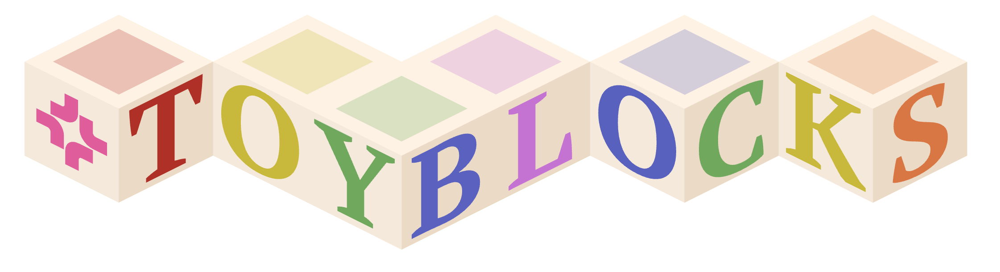

<p align="center">
  
</p>

# ManiFlow Training

<h3 align="center">
  <a href="https://allenai.github.io/ToyBlocks/docs/user_guide/workflows/imitation_learning.html">Docs</a> &nbsp;|&nbsp;
  <a href="https://huggingface.co/allenai/maniflow-tb">Model</a> &nbsp;|&nbsp;
  <a href="https://github.com/allenai/ToyBlocks">ToyBlocks</a>
</h3>

Training scripts for the ManiFlow multi-modal policy (RGB, optionally with depth) on LeRobot-format datasets.
ManiFlow is the low-level policy of [ToyBlocks](https://github.com/allenai/ToyBlocks), which includes this
repository as its `maniflow-tb` submodule (Python package `hvla`), trains it on ToyBlocks-generated data and
evaluates the checkpoints with its policy server (see [Evaluation](#3-evaluation)).

The ToyBlocks docs cover the full workflow:

- [Training ManiFlow Policies on Automatically Generated Data](https://allenai.github.io/ToyBlocks/docs/user_guide/workflows/imitation_learning.html):
  setup, a training run, GPUs and nodes, resuming, outputs and evaluation.
- [`train_maniflow.py` Reference](https://allenai.github.io/ToyBlocks/docs/user_guide/workflows/imitation_learning/train_maniflow.html):
  every flag of `scripts/train_maniflow.py`.
- [Automatic Data Generation](https://allenai.github.io/ToyBlocks/docs/user_guide/workflows/data_generation.html):
  the datasets these scripts train on.

A checkpoint trained with these scripts is on Hugging Face: [allenai/maniflow-tb](https://huggingface.co/allenai/maniflow-tb).
Its model card lists the architecture, the training settings and closed-loop eval results.

Setup of a standalone conda environment is described in [INSTALL.md](INSTALL.md). Inside ToyBlocks, the `maniflow`
extra installs this repository in editable mode (see the docs' Setup section).

---

## Quick Start

### 1. Running locally

A short debug run on one GPU:

```bash
# From the repository root (inside ToyBlocks: python maniflow-tb/scripts/train_maniflow.py)
CUDA_VISIBLE_DEVICES=0 WANDB_MODE=offline \
python scripts/train_maniflow.py \
  --num_gpus_per_node 1 \
  --run_root_dir runs \
  --duration 100 \
  --save_interval 100 \
  --logging_frequency 10 \
  --dbs 4 \
  --num_workers 0 \
  --data_root_dir /path/to/lerobot_dataset \
  --max_episodes 500
```

### 2. Full training runs

With the defaults (front and gripper RGB, 200k steps, batch 128 per GPU on all visible GPUs):

```bash
python scripts/train_maniflow.py --data_root_dir /path/to/lerobot_dataset
```

With pre-resized 224x224 RGB videos (`--rgb_224`). The run fails if a dataset has no `<camera>_224` videos;
[scripts/rgb_conversion](scripts/rgb_conversion/README.md) creates them:

```bash
python scripts/train_maniflow.py \
  --rgb_224 --data_root_dir /path/to/lerobot_dataset \
  --max_episodes 5000
```

With depth packed as rg8_55 videos. No dataset ships with them, and a missing variant trains on zeros, so create
them first with [scripts/depth_conversion](scripts/depth_conversion/README.md):

```bash
python scripts/train_maniflow.py \
  --rgb_224 --data_root_dir /path/to/lerobot_dataset \
  --max_episodes 5000 --depth --depth_rg8 rg8_55_224
```

`scripts/train_maniflow.py` uses all visible GPUs by default (`--num_gpus_per_node`). For several nodes, run it on
every node with the same flags plus `--num_nodes N --node_rank R --master_addr <node 0> --run_id <name>`.
`--resume <run_id>` continues a run from its latest checkpoint. `python scripts/train_maniflow.py --help` lists all
options, and the [Reference](https://allenai.github.io/ToyBlocks/docs/user_guide/workflows/imitation_learning/train_maniflow.html)
documents each one.

### 3. Evaluation

Checkpoints are evaluated with ToyBlocks' policy server, which loads the model with this repository. A run directory
`runs/<run_id>/` holds what the server needs: `checkpoints/steps_<N>_model.safetensors` (the weights), `config.yaml`
and `stats.json`. From the ToyBlocks repository root:

```bash
python scripts/launch_eval.py --policy maniflow \
    --model-path runs/<run_id>/checkpoints/steps_200000_model.safetensors \
    --dataset-path /path/to/lerobot_dataset
```

See [Policy Evaluation](https://allenai.github.io/ToyBlocks/docs/user_guide/workflows/evaluations.html) for the rest
of the eval workflow. The trained checkpoint on Hugging Face,
[allenai/maniflow-tb](https://huggingface.co/allenai/maniflow-tb), has the same layout:

```bash
hf download allenai/maniflow-tb --local-dir maniflow-tb
```

Its model card's results use `--expert-timeout-scale 3.0`; with the default 30 s episode limit most episodes time out
before the task is finished.

## License

This code is released under the [Apache License 2.0](LICENSE).
